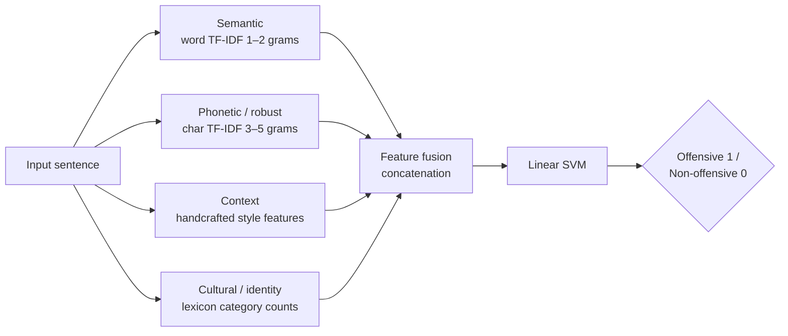

# LCM-GUARD: 4-Modal Fusion for Multilingual Offensive Language Detection

**Detects offensive and non-offensive text across 8 Indian languages, including code-mixed and romanised social-media text. Each input is analysed through four complementary feature modalities, fused, and classified. The results are benchmarked against classical ML, deep learning and Transformer models (mBERT, IndicBERT).**

---

## The Problem

Indian social-media text is hard for single-representation models:

- **Code-mixing:** Telugu-English, Tamil-English, Hinglish and so on
- **Phonetic and romanised spellings and slang**, e.g. *"Nuvvu idiot ra"*
- **Misspelled or obfuscated abuse**
- **Short, incomplete sentences**
- **Cultural, political and community references** that carry offensive intent

## The Solution: 4-Modal Fusion



| Module | Representation | What it captures |
|---|---|---|
| **Semantic** | Word-level TF-IDF (unigrams + bigrams) | The meaning and topic of the sentence |
| **Phonetic / robust** | Character TF-IDF (3–5 grams) | Misspellings, transliteration, obfuscated abuse |
| **Context** | Emoji count, punctuation, repeated characters, length, special symbols, caps ratio | Writing style and emphasis in short, noisy text |
| **Cultural / entity** | Counts per lexicon category: religion, caste/community, politics, slurs, threats | Identity-targeted offensive patterns |

## Dataset

- **Format:** `id | language | text | label` (0 = non-offensive, 1 = offensive)
- **Languages (8):** English, Hindi, Marathi, Bengali, Tamil, Telugu, Kannada, Malayalam
- **Sources:** HASOC, Dravidian-language offensive datasets, and **our own Telugu dataset**

## Model Comparison Strategy

| Family | Models |
|---|---|
| Classical ML | Logistic Regression · Linear SVM · SVM (RBF) · Random Forest · XGBoost |
| Deep learning | RNN · BiLSTM · GRU · CNN |
| Transformers | mBERT · **IndicBERT** |

**Why IndicBERT:** it is pretrained on large Indian-language corpora and handles code-mixed text better than general multilingual models like mBERT.

### IndicBERT pipeline

1. Tokenisation: `"Nuvvu idiot ra"` → `[CLS] nu ##vvu idiot ra [SEP]`
2. Token, position and segment embeddings
3. Transformer encoder layers (multi-head self-attention, feed-forward, layer norm, residuals)
4. The `[CLS]` embedding represents the whole sentence
5. A fully connected layer with softmax gives, for example, Offensive = 0.91 and Non-Offensive = 0.09

## Project Structure

```
LCM-GUARD-Multilingual-Offensive-Language-Detection/
├── data/                      # dataset.csv (id, language, text, label)
├── lexicons/categories.json   # cultural / identity lexicon (extend per language)
├── src/
│   ├── features.py            # 4 modality feature extractors + fusion
│   ├── train_fusion.py        # LCM-GUARD fusion + classical ML comparison
│   ├── train_indicbert.py     # IndicBERT / mBERT fine-tuning
│   └── predict.py             # inference on new text
└── requirements.txt
```

## Getting Started

```bash
pip install -r requirements.txt
python src/train_fusion.py --data data/dataset.csv          # fusion model + baselines
python src/train_indicbert.py --data data/dataset.csv       # transformer fine-tuning
python src/predict.py "Nuvvu idiot ra"
```

## Conclusion

Combining semantic, phonetic, contextual and cultural features makes detection more robust than any single representation. Transformer models such as IndicBERT add stronger contextual understanding for multilingual and code-mixed social-media text.

## Tech Stack

Python · scikit-learn · XGBoost · PyTorch · Hugging Face Transformers · pandas · NumPy

## Team

Team 12 · Amrita Vishwa Vidyapeetham, Coimbatore

- Dodla Nithya Sai
- M. Vishnu Vardhan
- P. Sreekar Reddy
- S. Beena Reddy
